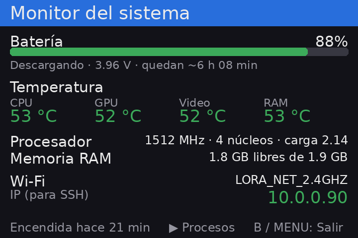

# Monitor del sistema para Anbernic

App para consolas **Anbernic con el sistema original** (chip H700, como la RG34XX SP) que muestra en
vivo el estado de la consola: batería, temperaturas, procesador, memoria y conexión Wi-Fi.

Se abre desde la sección **APPS** del menú, como el Reloj u otras apps de Anbernic.



## Qué hace

La pantalla se actualiza **cada segundo** y muestra:

| Sección | Qué muestra |
|---|---|
| **Batería** | Porcentaje con barra de color, si está cargando o descargando, voltaje y tiempo estimado (hasta llenarse o hasta agotarse). Avisa si el cable USB está conectado. |
| **Temperatura** | CPU, GPU, decodificador de video y RAM. Verde por debajo de 60 °C, amarillo hasta 75 °C, rojo por encima. |
| **Procesador** | Frecuencia actual, cantidad de núcleos y carga promedio. |
| **Memoria RAM** | Memoria libre y total. |
| **Wi-Fi** | Nombre de la red y la **dirección IP** de la consola, que es la que necesitas para conectarte por SSH o transferir archivos. Si no hay conexión, dice "sin conexión". |
| **Pie** | Cuánto tiempo lleva encendida la consola. |

Para qué sirve, por ejemplo:

- Ver si un juego o port está **calentando** la consola.
- Saber **cuánta batería queda** en horas y minutos, no solo en porcentaje.
- Encontrar la **IP** de la consola sin entrar a la configuración de red.

### Botones

| Botón | Acción |
|---|---|
| **B** o **MENU** | Salir |

## Requisitos

- Consola Anbernic con chip **H700** y el **sistema original** de Anbernic (no Knulli, muOS, etc.).
- Pantalla de **720×480** (RG34XX SP, RG34XX H). En otras resoluciones la imagen saldría desacomodada.
- No hay que instalar nada más: usa Python y Pillow, que ya vienen en el sistema.

## Instalación

La app son **4 archivos** que van dentro de la carpeta `Roms/APPS` de cualquiera de las dos tarjetas
(el menú lee las dos):

```
Roms/APPS/Monitor.sh
Roms/APPS/monitor/main.py
Roms/APPS/monitor/fbui.py
Roms/APPS/Imgs/Monitor.png
```

### Opción A: con la tarjeta en la PC

1. En esta página de GitHub, presiona **Code → Download ZIP** y descomprímelo.
2. Apaga la consola, saca una de las tarjetas microSD y ponla en la PC.
3. Abre la carpeta `Roms/APPS` de la tarjeta.
4. Copia ahí, desde la carpeta descomprimida:
   - el archivo `Monitor.sh`
   - la carpeta `monitor` completa
   - el archivo `Imgs/Monitor.png` **dentro** de la carpeta `Imgs` que ya existe en `APPS`
     (no reemplaces esa carpeta: tiene los íconos de las otras apps).
5. Expulsa la tarjeta, vuelve a ponerla en la consola y enciéndela.

No hace falta copiar `docs`, `tools` ni el `README.md`.

### Opción B: por Wi-Fi (SSH)

Si la consola está conectada a Wi-Fi y tiene SSH activado, desde la carpeta del repositorio en la PC
(cambia la IP por la de tu consola; el usuario es `root` y la contraseña del sistema original es `root`):

```bash
scp -r Monitor.sh monitor root@IP_DE_LA_CONSOLA:/mnt/mmc/Roms/APPS/
```

```bash
scp Imgs/Monitor.png root@IP_DE_LA_CONSOLA:/mnt/mmc/Roms/APPS/Imgs/
```

`/mnt/mmc` es la tarjeta 1; para la tarjeta 2 usa `/mnt/sdcard`.

### Abrirla

En el menú de la consola entra a **APPS → Monitor**. Si no aparece, reinicia la consola para que se
actualice la lista.

## Actualizar o desinstalar

- **Actualizar:** copia de nuevo los archivos encima de los anteriores.
- **Desinstalar:** borra `Monitor.sh`, la carpeta `monitor` y `Imgs/Monitor.png`.

La app no modifica nada del sistema: solo lee información.

## Problemas comunes

| Problema | Solución |
|---|---|
| No aparece en APPS | Revisa que `Monitor.sh` esté directamente en `Roms/APPS` (no en una subcarpeta) y reinicia la consola. |
| Aparece sin ícono | El PNG debe estar en `Roms/APPS/Imgs/` con el mismo nombre que el `.sh`. |
| Se abre y vuelve al menú enseguida | Revisa `Roms/APPS/monitor/log.txt`, ahí queda el error. |
| Wi-Fi dice "sin conexión" estando conectada | La app busca la interfaz `wlan0`; si tu consola usa otro nombre, cámbialo en `wifi()` dentro de `main.py`. |

## Cómo funciona (técnico)

- **`monitor/fbui.py`**: módulo pequeño y reutilizable para hacer apps en esta consola.
  - `Screen`: abre `/dev/fb0`, aplica la configuración de pantalla de las apps oficiales
    (`/mnt/mod/ctrl/configs/fb.cfg`) y escribe cada imagen en **todas las páginas** del framebuffer
    de doble búfer (si no, la pantalla puede quedar negra).
  - `Input`: lee `/dev/input/event1` sin bloquear, con `select()` y tiempo de espera, para refrescar
    la pantalla cada segundo mientras espera un botón.
  - Utilidades de dibujo: cabecera, pie, recorte de texto, ajuste de líneas y tamaños legibles.
- **`monitor/main.py`**: lee todo de archivos del kernel, sin programas externos salvo `iw` e `ip`:

| Dato | Fuente |
|---|---|
| Batería | `/sys/class/power_supply/axp2202-battery/*` |
| Cargador USB | `/sys/class/power_supply/axp2202-usb/online` |
| Temperaturas | `/sys/class/thermal/thermal_zone*/{type,temp}` |
| CPU | `/sys/devices/system/cpu/cpu*/cpufreq/scaling_cur_freq`, `/proc/loadavg` |
| RAM | `/proc/meminfo` (`MemAvailable`) |
| Wi-Fi | `iw dev wlan0 link` (red) e `ip -4 addr show wlan0` (IP) |

Para probar sin tocar la pantalla (por ejemplo, por SSH):

```bash
python3 monitor/main.py --png salida.png
```

`tools/make_icon.py` genera el ícono de 240×180:

```bash
python3 tools/make_icon.py monitor Imgs/Monitor.png
```

## Compatibilidad

Probado en una **RG34XX SP** con el sistema original **1.0.6** (chip de carga AXP2202).
